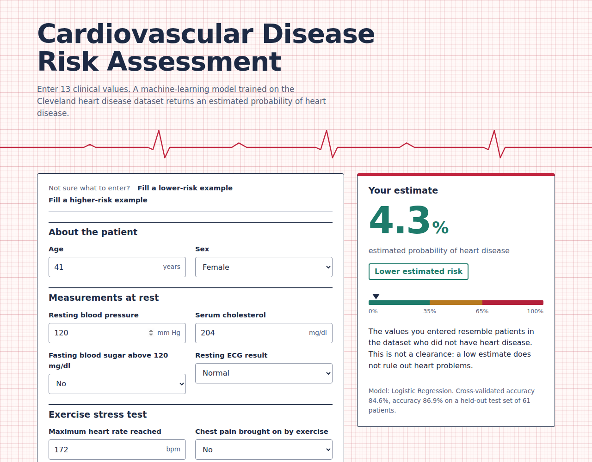
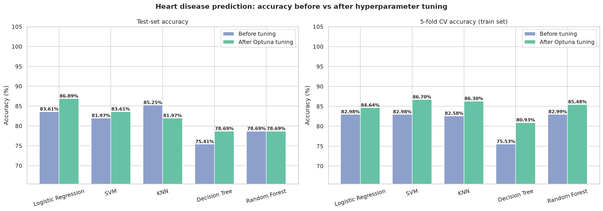
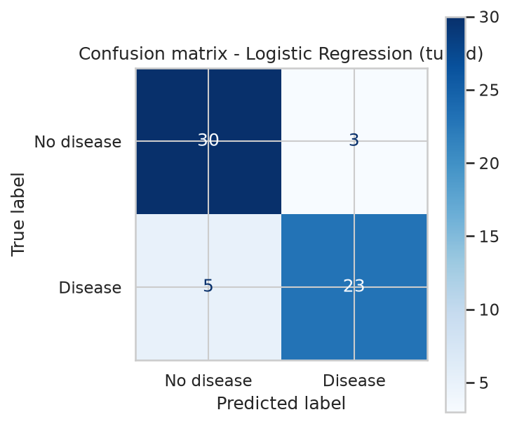
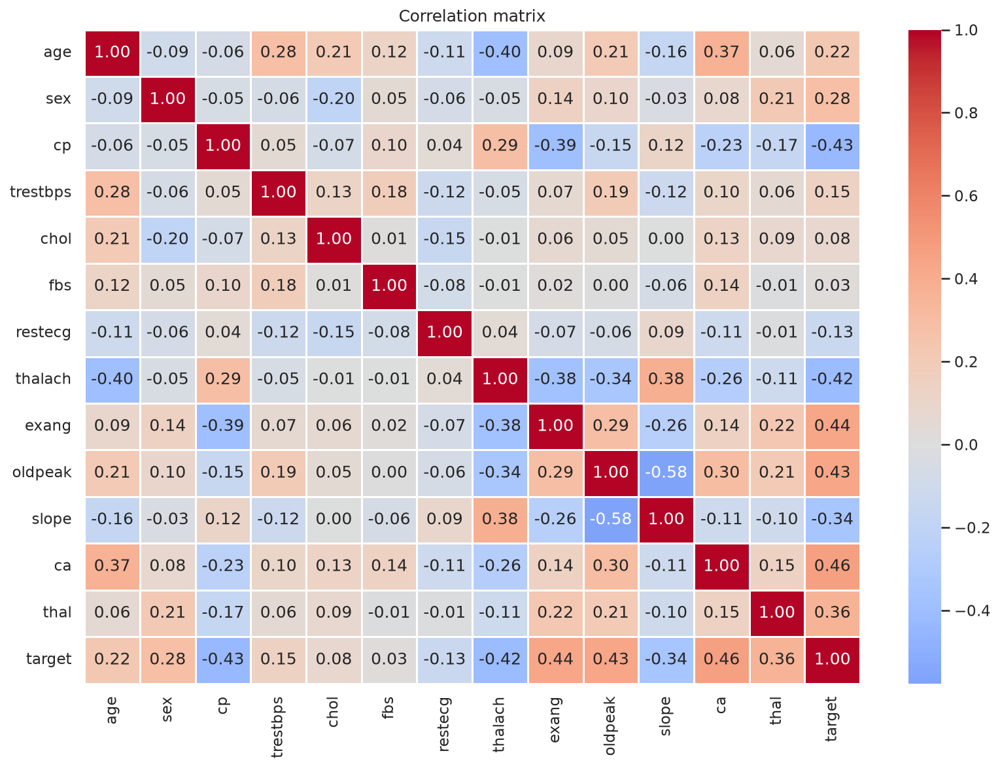

# Cardiovascular Disease Risk Assessment & Prediction Model

A complete machine-learning project: from exploratory analysis and model comparison to a web app that estimates the probability of heart disease from 13 clinical values.

> **For education and research only.** This project does not diagnose, treat or rule out any medical condition and must not be used for clinical decisions.

**Live demo:** `https://<your-service-name>.onrender.com` *(replace after you deploy, see [DEPLOYMENT_GUIDE.md](DEPLOYMENT_GUIDE.md))*



## Table of contents

- [What this project does](#what-this-project-does)
- [Dataset](#dataset)
- [Machine-learning pipeline](#machine-learning-pipeline)
- [Results](#results)
- [Project structure](#project-structure)
- [Quick start](#quick-start)
- [Using the API](#using-the-api)
- [Deployment](#deployment)
- [Limitations](#limitations)
- [Future work](#future-work)
- [Acknowledgements](#acknowledgements)
- [License](#license)

## What this project does

1. **Trains and compares five classifiers** on the Cleveland heart disease data: Logistic Regression, SVM, KNN, Decision Tree and Random Forest.
2. **Tunes every model with Optuna** and reports accuracy before and after tuning.
3. **Exports the best model** and serves it through a Flask web app with input validation, a risk gauge and a JSON API.

## Dataset

`data/heart.csv` has 303 rows (302 after removing one duplicate), 13 features and a binary target. It is the widely used Cleveland subset of the UCI Heart Disease data.

| Feature | Meaning | Coding in `heart.csv` |
|---|---|---|
| `age` | Age in years | number |
| `sex` | Sex | 1 = male, 0 = female |
| `cp` | Chest pain type | 0 = asymptomatic, 1 = atypical angina, 2 = non-anginal pain, 3 = typical angina |
| `trestbps` | Resting blood pressure (mm Hg) | number |
| `chol` | Serum cholesterol (mg/dl) | number |
| `fbs` | Fasting blood sugar above 120 mg/dl | 1 = yes, 0 = no |
| `restecg` | Resting ECG result | 0 = left ventricular hypertrophy, 1 = normal, 2 = ST-T wave abnormality |
| `thalach` | Maximum heart rate reached | number |
| `exang` | Exercise-induced chest pain | 1 = yes, 0 = no |
| `oldpeak` | ST depression after exercise vs rest | number |
| `slope` | Slope of the peak-exercise ST segment | 0 = downsloping, 1 = flat, 2 = upsloping |
| `ca` | Major vessels coloured by fluoroscopy | 0 to 3 |
| `thal` | Thallium stress test | 1 = fixed defect, 2 = normal, 3 = reversible defect |
| `target` | Outcome | see the note below |

### Two data issues worth knowing about

**1. The target is inverted in this file.** In `heart.csv`, `target = 1` means *no* heart disease. Evidence: the class sizes (164 vs 138 after de-duplication) match the original Cleveland data (164 healthy, 139 with disease), and every established risk marker (exercise angina, vessels coloured, ST depression) is *lower* when `target = 1` while maximum heart rate is *higher*. `train_model.py` therefore recodes the target (`INVERT_TARGET = True`) so that **1 = disease present**, and prints this evidence when it runs. Model accuracy is unaffected, but the probabilities shown on the website depend on it being right.

**2. Category codes follow the file, not every online description.** Several descriptions of this dataset list different meanings for `cp`, `restecg`, `slope` and `thal`. The mapping above was derived by matching the category counts in the file to the original UCI Cleveland counts (for example, 143 rows with `cp = 0` match the 144 asymptomatic patients in the original data). Please verify it against your own data source before relying on it.

Also handled: `ca = 4` (4 rows) and `thal = 0` (2 rows) are invalid codes and are replaced by the column mode.

## Machine-learning pipeline

| Step | What happens |
|---|---|
| 1. Load | Read `data/heart.csv` |
| 2. Clean | Drop duplicate rows, fix invalid codes, recode the target, report outliers (kept, not removed) |
| 3. EDA | Target balance, histograms, boxplots, categorical-vs-target plots, correlation heatmap |
| 4. Split | 80/20 stratified train-test split (241 train, 61 test), `random_state=42` |
| 5. Preprocess | `StandardScaler` on continuous features, one-hot encoding for `cp`, `restecg`, `slope`, `thal`, inside a scikit-learn `Pipeline` so nothing leaks from validation or test data |
| 6. Baseline | Five models with default settings: test accuracy and 5-fold CV accuracy |
| 7. Tune | Optuna (TPE sampler, 50 trials per model), objective = 5-fold CV accuracy on the training set only |
| 8. Evaluate | Retrain with the best parameters, score once on the untouched test set |
| 9. Export | Refit the best configuration on all 302 rows and save `model/heart_model.joblib` and `model/model_metadata.json` |

## Results

Results from one run with the pinned library versions in `requirements.txt` (Python 3.12, scikit-learn 1.5.1, seed 42):

| Model | CV accuracy before | CV accuracy after | Test accuracy before | Test accuracy after |
|---|---|---|---|---|
| Logistic Regression | 82.98% | 84.64% | 83.61% | **86.89%** |
| SVM | 82.98% | **86.70%** | 81.97% | 83.61% |
| KNN | 82.58% | 86.30% | 85.25% | 81.97% |
| Decision Tree | 75.53% | 80.93% | 75.41% | 78.69% |
| Random Forest | 82.99% | 85.48% | 78.69% | 78.69% |



**Conclusion.** Logistic Regression has the best tuned test accuracy (86.89%) and is the model deployed on the website. SVM has the best cross-validated accuracy (86.70%). Tuning raised the CV accuracy of all five models, but test accuracy rose for three, stayed the same for one and fell for KNN.

**Read these numbers with care.** The test set has 61 patients, so a single prediction is worth 1.64 percentage points, and the top models are within noise of each other. Treat the cross-validated accuracy as the steadier estimate. Your numbers may differ slightly if you use other library versions.

| Confusion matrix (best model, test set) | Feature correlations |
|---|---|
|  |  |

## Project structure

```
.
├── app.py                    Flask app (page, /api/predict, /api/model-info, /health)
├── features.py               Form fields, valid ranges and example profiles
├── train_model.py            Full ML pipeline + model export
├── data/heart.csv            Dataset
├── model/                    heart_model.joblib + model_metadata.json (created by train_model.py)
├── templates/index.html      Web page
├── static/                   style.css, script.js
├── docs/                     Images used in this README
├── requirements.txt          Packages needed to run the website
├── requirements-train.txt    Extra packages needed to retrain (Optuna, matplotlib, seaborn)
├── Procfile                  Start command for hosting platforms
├── render.yaml               Render Blueprint
├── DEPLOYMENT_GUIDE.md       Step-by-step deployment guide
└── LICENSE
```

## Quick start

Requires **Python 3.12** (the pinned package versions do not support newer Python releases).

```bash
git clone https://github.com/<your-username>/<your-repo>.git
cd <your-repo>

# create and activate a virtual environment
python -m venv .venv
source .venv/bin/activate          # Windows PowerShell: .venv\Scripts\Activate.ps1

# 1) train the model (about a minute; saves plots to outputs/ and the model to model/)
pip install -r requirements-train.txt
python train_model.py              # add --no-show to skip plot windows, --trials 100 for a longer search

# 2) run the website
python app.py                      # open http://127.0.0.1:5000
```

If you only want the website and the `model/` folder is already in the repository, skip step 1 and install `requirements.txt` instead.

## Using the API

```bash
curl -X POST http://127.0.0.1:5000/api/predict \
  -H "Content-Type: application/json" \
  -d '{"age":58,"sex":1,"cp":0,"trestbps":140,"chol":260,"fbs":0,"restecg":1,
       "thalach":120,"exang":1,"oldpeak":2.0,"slope":1,"ca":1,"thal":3}'
```

```json
{
  "probability": 95.3,
  "band": "high",
  "band_label": "Higher estimated risk",
  "cutoffs": {"low": 35.0, "high": 65.0},
  "warnings": [],
  "model": {"name": "Logistic Regression", "cv_accuracy": 84.6, "test_accuracy": 86.9, "n_test": 61, "rows_used": 302}
}
```

All 13 fields are required. Invalid input returns HTTP 422 with an `errors` object naming each bad field. Values that are valid but outside the training range return a `warnings` entry. `GET /api/model-info` describes the loaded model and `GET /health` is a liveness check.

## Deployment

The app is a standard Flask application served by gunicorn. [DEPLOYMENT_GUIDE.md](DEPLOYMENT_GUIDE.md) walks through publishing it on Render (free tier available), with PythonAnywhere as an alternative, plus updating, custom domains and troubleshooting.

## Limitations

- **Not a medical device.** The estimate reflects patterns in one small, historical dataset, not an examination of a person.
- **Small, single-source data.** 302 patients from one clinic population, with far more men than women, so performance for other groups is unknown.
- **Noisy evaluation.** A 61-patient test set cannot separate models that differ by a few points.
- **Coding assumptions.** See [the two data issues](#two-data-issues-worth-knowing-about) above.
- **No data is stored.** The app keeps nothing a user enters, and you should keep it that way unless you add proper consent and security.

## Future work

- Repeated or nested cross-validation for more reliable model comparison
- Probability calibration plots and a decision-threshold analysis
- SHAP explanations for each prediction
- External validation on a different heart disease dataset
- Automated tests and a CI workflow

## Acknowledgements

Dataset: Janosi, A., Steinbrunn, W., Pfisterer, M., & Detrano, R. (1988). *Heart Disease*. UCI Machine Learning Repository. https://doi.org/10.24432/C52P4X

## License

Released under the MIT License. See [LICENSE](LICENSE).
